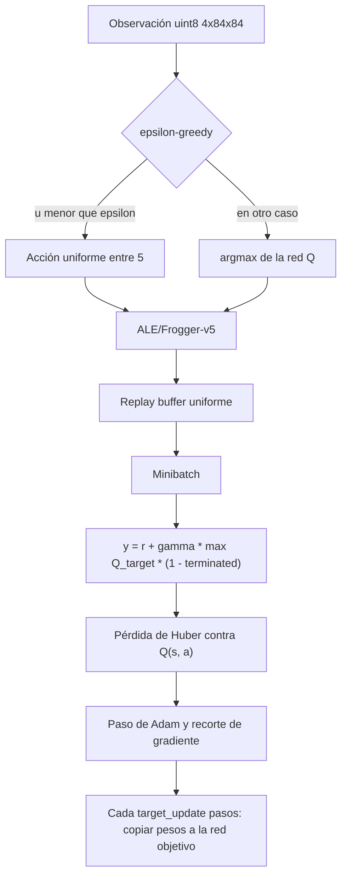

# frogger-rl-lab

Repositorio de la asignatura **Simulación y Aprendizaje por Refuerzo** (Universidad de
La Sabana). Un mismo código cubre dos entregas sobre **`ALE/Frogger-v5`**
(Atari 2600, Gymnasium / Arcade Learning Environment):

1. **Taller U3 — DQN**, escrito a mano en PyTorch puro (`dqn_frogger.py`).
   No usa Stable-Baselines3.
2. **Mini-ejercicio U4 — PPO**, el notebook `ppo_frogger.ipynb` con
   Stable-Baselines3. Sigue funcionando igual que antes.

`ALE/Frogger-v5` es **Atari, no Sega/Genesis**. No hay Lunar Lander. No se
redistribuyen ROMs: `ale-py==0.12.1` trae las ROMs dentro de la rueda, que es
la vía de licencia aceptada por AutoROM que ya usaba este repositorio.

## Estructura

```
frogger-rl-lab/
├── dqn_frogger.py          # DQN a mano: buffer, epsilon-greedy, Q y target, Bellman, CLI
├── frogger_rl.py           # entorno y evaluación compartidos (testeados)
├── ppo_frogger.ipynb       # notebook PPO (U4), sin salidas ejecutadas
├── tests/                  # helper, notebook y DQN (buffer / formas / TD)
├── entregables/u3_dqn/     # corrida real de DQN (curva, métricas, GIF, pesos)
├── entregables/u4_ppo/     # corrida real de PPO a 100 000 pasos (curva, comparación, GIF)
├── pyproject.toml          # dependencias uv
└── README.md
```

`results/`, `logs/`, `models/` y `checkpoint.pt` (el estado del optimizador) no
se versionan. Los pesos de la red Q sí: `entregables/u3_dqn/q_network.pt`.

## Puesta en marcha

Hace falta [uv](https://docs.astral.sh/uv/) y Python 3.11–3.13.

```bash
git clone https://github.com/AlejoMoncada/frogger-rl-lab.git
cd frogger-rl-lab
uv sync --frozen
```

Pruebas:

```bash
uv run python -m unittest discover -s tests -p 'test_*.py' -v
```

---

## Taller U3 — DQN (PyTorch puro)

El agente vive en `dqn_frogger.py`. Importar ese módulo no crea el emulador.
El entorno sale de `frogger_rl.make_env`, el mismo contrato que el notebook de PPO.

### Espacio de observación y de acciones

| | |
|---|---|
| Entorno | `ALE/Frogger-v5` |
| Observación | `uint8` de forma `(4, 84, 84)`, canal primero |
| Acciones | `Discrete(5)`: `NOOP`, `UP`, `RIGHT`, `LEFT`, `DOWN` |

La observación se construye así:

* el emulador base nace con `frameskip=1` y `repeat_action_probability=0.25`
  (acciones pegajosas, en una sola capa);
* `AtariPreprocessing(frame_skip=4, screen_size=84, grayscale_obs=True,
  scale_obs=False, terminal_on_life_loss=False)` produce un fotograma gris
  84×84 sin dividir entre 255;
* `FrameStackObservation(stack_size=4)` apila los últimos cuatro fotogramas.

La red divide entre 255 dentro de `forward`. Cuatro fotogramas compensan, en
parte, que el juego sea parcialmente observable: de un solo cuadro no se ve
hacia dónde se mueve un auto o un tronco.

### Recompensa

La recompensa es la de ALE, **cruda**: no se recorta a \[-1, 1\] ni se
reformula. Eso se aparta del artículo de Nature a propósito, para que el
retorno sea comparable con el baseline aleatorio y con el notebook de PPO.

En la práctica del emulador, el retorno sube de a **1.0** cuando la rana
avanza y se queda en 0 el resto de los pasos. No es una recompensa densa.

### Terminación del episodio

* **`terminated`**: el juego se acaba (las vidas llegan a 0). Perder una vida
  no corta el episodio, porque `terminal_on_life_loss=False`.
* **`truncated`**: el `TimeLimit` exterior corta a los 2700 pasos de agente
  (un paso de agente = 4 frames del emulador). No es una victoria.

En el objetivo de Bellman solo `terminated` anula el bootstrap. Un corte por
tiempo sigue estimando `max Q_target(s', ·)`, porque la partida seguía viva.

### Flujo del algoritmo

DQN clásico (Mnih et al., 2015), no Double DQN:

1. Se guarda la transición `(s, a, r, s', terminated, truncated)` en un buffer
   uniforme. Las observaciones quedan en `uint8`.
2. La acción es **epsilon-greedy** con decaimiento lineal de `epsilon_start`
   a `epsilon_end` a lo largo de `epsilon_decay_steps`. El azar sale de un
   generador de NumPy local, no del RNG global.
3. Hay dos CNN iguales: la red Q (la que se entrena) y la **red objetivo**
   (copia dura de los pesos cada `target_update` pasos).
4. Cada `train_freq` pasos, pasado `learning_starts`, se muestrea un minibatch
   y se minimiza la pérdida de Huber (Smooth L1) entre `Q(s, a)` y el blanco
   de Bellman:

```text
y = r + gamma * max_a' Q_target(s', a') * (1 - terminated)
```



### Arquitectura de la red

Nature DQN. Entrada `(N, 4, 84, 84)` escalada a \[0, 1\]. Salida `(N, 5)`,
sin activación: son los valores Q.

| Capa | Operación | Salida |
|---|---|---|
| Conv | 32 filtros 8×8, stride 4, ReLU | 32 × 20 × 20 |
| Conv | 64 filtros 4×4, stride 2, ReLU | 64 × 9 × 9 |
| Conv | 64 filtros 3×3, stride 1, ReLU | 64 × 7 × 7 |
| Flatten | | 3136 |
| Linear | 512 unidades, ReLU | 512 |
| Linear | 5 acciones | 5 |

Unos 1.69 millones de parámetros. El optimizador es Adam (`lr=1e-4`), no el
RMSProp del artículo, con recorte de gradiente en norma 10. La última capa
lineal arranca cerca de cero para que el Q inicial no sea enorme.

### CLI

Entrenar (todos los hiperparámetros se pueden pisar):

```bash
uv run python -m dqn_frogger train --help
uv run python -m dqn_frogger train --total-steps 200000 --device cpu --output-dir entregables/u3_dqn
```

Evaluar un checkpoint ya guardado, otra vez contra el azar y con las mismas
semillas:

```bash
uv run python -m dqn_frogger eval \
  --checkpoint entregables/u3_dqn/q_network.pt \
  --episodes 10 \
  --device cpu \
  --gif \
  --output-dir results/frogger_dqn_eval
```

`--device auto` elige `cuda` si existe, si no `mps` cuando
`torch.backends.mps.is_available()` es verdadero, y si no `cpu`.

El entrenamiento escribe:

* `learning_curve.png` — retorno por episodio, media móvil, línea del baseline
  aleatorio, y la pérdida TD junto con epsilon;
* `metrics.json` — hiperparámetros, episodios, evaluación greedy y aleatoria
  con las mismas semillas, tiempo real, actualizaciones del optimizador;
* `eval.gif` — un episodio greedy en RGB;
* `q_network.pt` — pesos para volver a evaluar;
* `checkpoint.pt` — redes + Adam (no se sube a git: pesa más y está en
  `.gitignore`).

### Corrida versionada en este repositorio

Comando exacto, en CPU, de los archivos que están en `entregables/u3_dqn/`:

```bash
uv run python -m dqn_frogger train \
  --total-steps 200000 \
  --buffer-size 20000 \
  --batch-size 32 \
  --gamma 0.99 \
  --lr 1e-4 \
  --epsilon-start 1.0 \
  --epsilon-end 0.1 \
  --epsilon-decay-steps 160000 \
  --learning-starts 2000 \
  --train-freq 4 \
  --target-update 2500 \
  --max-episode-steps 2700 \
  --seed 2026 \
  --eval-episodes 10 \
  --eval-seed-base 777001 \
  --eval-max-episode-steps 2700 \
  --device cpu \
  --output-dir entregables/u3_dqn \
  --log-every 10000 \
  --checkpoint-every 50000
```

200 000 pasos de agente son 800 000 frames del emulador (frame skip 4). El
DQN de Nature usó del orden de 200 millones de frames. Esta corrida es real
—hay decenas de miles de pasos de gradiente— y a la vez es corta para Frogger.

El buffer de 20 000 transiciones es un tope de memoria: cada transición guarda
dos stacks `uint8` de `(4, 84, 84)`, cerca de 1 GB. En un Mac con más RAM se
puede subir `--buffer-size`.

#### Resultados numéricos

Los valores salen de `entregables/u3_dqn/metrics.json` y de `train.log` de esa
corrida (CPU, torch `2.14.1+cpu`, sin CUDA ni MPS). No son estimaciones.

La corrida duró **927.6 s** (unos 15.5 min), a unos 217 pasos de agente por
segundo al final. El optimizador dio **49 500** pasos de gradiente. El cambio
máximo de un parámetro respecto al arranque fue **0.463**, así que los pesos
sí se movieron.

Durante el entrenamiento se completaron **761** episodios. Los **761**
terminaron por fin de juego (`terminated`); ninguno llegó al tope de 2700
(`truncated` = 0). Al cortar los 200 000 pasos quedó un episodio a medias
(retorno 7, 146 pasos) que no entra en las medias.

| Tramo del entrenamiento | Retorno medio crudo |
|---|---|
| 761 episodios | 12.90 |
| primeros 20 | 9.3 |
| últimos 20 | 17.2 |
| primeros 50 | 9.52 (mín 6, máx 17) |
| últimos 50 | 17.10 (mín 10, máx 26) |

El máximo visto en entrenamiento fue 28. La curva (`learning_curve.png`) sube
con ruido: la media móvil pasa de alrededor de 10 a alrededor de 17. Esa curva
**incluye exploración** (epsilon baja de 1.0 a 0.1). No es la política greedy.

La comparación justa es la evaluación final, con epsilon = 0, las mismas 10
semillas (`777001`–`777010`) y el mismo tope de 2700 pasos para el DQN y para
el azar:

| Política | Retorno medio | Desv. estándar | Mín | Máx | Largo medio (pasos) |
|---|---|---|---|---|---|
| DQN greedy | 20.1 | 2.43 | 14 | 24 | 348.5 |
| Aleatoria | 10.1 | 2.34 | 8 | 16 | 297.4 |

Diferencia de medias: **+10.0** a favor del DQN. En estas 10 semillas el greedy
gana el retorno en las diez; el peor greedy (14, semilla 777007) queda por
debajo del mejor aleatorio (16, semilla 777010), así que las distribuciones se
tocan por los extremos. Aun así la separación de medias es grande frente a una
desviación de ~2.4 con n = 10. Los diez episodios de ambas políticas
**terminan por muerte**. Nadie llega al tope de 2700 ni, por el marcador, a
cerrar el nivel: 20 puntos siguen siendo los primeros saltos de la rana.

El GIF `eval.gif` es el episodio greedy de la semilla 777001: retorno **20**,
371 pasos, `terminated`, 180 cuadros guardados (de 372 capturados).

La pérdida de Huber no baja a cero: en el log pasa de ~0.014 a los 10 000
pasos a ~0.041 al final. Es coherente con blancos TD más grandes cuando el
retorno sube, no con un agente que “ya convergió”.

Es **una** semilla de entrenamiento (`2026`). Duplicar al azar en diez
episodios no es resolver Frogger ni un resultado de varias semillas.

### Entrenar más tiempo en el Mac (Apple Silicon)

Desde la copia local del estudiante. `uv sync --frozen` instala la rueda
`macosx_arm64` de PyTorch que ya resuelve el lockfile (no la rueda Linux
`+cpu`). `--device auto` usa **mps** si `torch.backends.mps.is_available()`
es verdadero; si no, se queda en CPU y el log imprime el dispositivo real.
Para forzarlo: `--device mps`.

```bash
cd /Users/williammoncada/Documents/MIA/ReinformentLearning/frogger-rl-lab
uv sync --frozen
uv run python -c "import torch; print('mps', torch.backends.mps.is_available())"
uv run python -m dqn_frogger train \
  --device auto \
  --total-steps 500000 \
  --buffer-size 50000 \
  --epsilon-decay-steps 400000 \
  --learning-starts 10000 \
  --target-update 5000 \
  --batch-size 32 \
  --gamma 0.99 \
  --lr 1e-4 \
  --seed 2026 \
  --eval-episodes 10 \
  --output-dir results/frogger_dqn_mac
```

500 000 pasos siguen siendo pocos frente a Nature, pero son más del doble de
la corrida de la VM y el buffer cabe mejor en un Mac. La salida cae en
`results/`, que git ignora. Cuando termine, la curva y el JSON quedan en ese
directorio. Para evaluar:

```bash
uv run python -m dqn_frogger eval \
  --checkpoint results/frogger_dqn_mac/q_network.pt \
  --device auto \
  --episodes 10 \
  --gif \
  --output-dir results/frogger_dqn_mac_eval
```

### Qué fue lo más difícil

Lo difícil no fue armar la CNN ni el paso de Bellman: eso es una fórmula
corta y las pruebas la fijan sin emulador. Lo difícil es que Frogger casi no
informa. La recompensa cruda es 0 en la mayoría de los pasos y solo sube de a
1 cuando la rana avanza; las acciones pegajosas (probabilidad 0.25) repiten
la orden anterior y desordenan el timing; y el episodio dura unos cientos de
pasos, así que con `gamma=0.99` el crédito de un salto temprano llega muy
apagado.

Encima, el presupuesto real de esta máquina es una fracción pequeña del DQN
de Nature, y el replay no puede guardar un millón de stacks sin quedarse sin
RAM. Epsilon pasa gran parte del entrenamiento cerca de 1, así que la red ve
sobre todo tráfico aleatorio. Aun así, en esta corrida la política greedy sí
se separó del azar (20.1 frente a 10.1 en las diez semillas held-out). Eso no
es “saber jugar”: los episodios siguen muriendo en el primer tramo de la
pantalla y el marcador no se parece a una partida terminada. La lectura
correcta es la tabla de arriba, no un récord humano. Si otra semilla no
superara al azar, el JSON lo diría igual de claro (`beats_random_mean`).

---

## Mini-ejercicio U4 — PPO (Stable-Baselines3)

El notebook `ppo_frogger.ipynb` no se reescribió. Sigue comparando, en los
mismos episodios held-out, una política **aleatoria**, el **PPO sin entrenar**
y el **PPO después de entrenar**. Exporta modelo, curva, comparación y un GIF.

### Cómo abrirlo

```bash
uv sync --frozen
uv run jupyter lab ppo_frogger.ipynb
```

En Jupyter Lab: **Run All**. Las celdas dependen de las anteriores.

| Variable | Efecto |
|---|---|
| `FROGGER_SMOKE=1` | PPO real pero diminuto: 256 pasos, `n_steps=64`, `n_epochs=1`, 2 episodios de evaluación por política, GIF corto. Prueba la plomería, no el aprendizaje. |
| `TRAIN_SEED=<int>` | Semilla de entrenamiento (default `2026`). Entero no negativo y distinto de las semillas held-out. |
| `FROGGER_OUTPUT_DIR=<dir>` | Directorio de salida. Por omisión: `results/frogger_ppo/`. |

**Modo normal (predeterminado):** 100 000 pasos, `n_steps=512`, `batch_size=64`,
`n_epochs=4`, `lr=2.5e-4`, `gamma=0.99`, `gae_lambda=0.95`, `clip_range=0.2`,
`ent_coef=0.01`, `vf_coef=0.5`, `device="cpu"`, 20 episodios de evaluación por
política y tope de 2700 pasos de agente.

Smoke reproducible, sin tocar el notebook fuente:

```bash
FROGGER_SMOKE=1 FROGGER_OUTPUT_DIR=/tmp/frogger-out \
  uv run jupyter nbconvert --to notebook --execute \
  --output-dir /tmp/frogger-out ppo_frogger.ipynb
```

Salidas bajo el directorio elegido, resumidas en `manifest.json`: `model.zip`,
`curve.csv` / `curve.png`, `comparison.json` / `comparison.csv`, y
`episodio_smoke.gif` o `episodio_ppo.gif`.

### Resultados de PPO

El modo normal del notebook (no el smoke) se ejecutó en esta VM, sin editar
`ppo_frogger.ipynb`. Stable-Baselines3 redondea el presupuesto al múltiplo de
`n_steps=512`, así que 100 000 pedidos fueron **100 352** pasos reales.
Salieron **6 272** actualizaciones del optimizador y un cambio máximo de
parámetro de **0.195** frente a la foto previa al `learn`. La recarga del zip
coincidió con la acción determinista (`reload_matches: true` en
`manifest.json`). Los archivos versionados están en `entregables/u4_ppo/`
(`comparison.json`, `curve.png`, `curve.csv`, `episodio_ppo.gif`,
`manifest.json`). El `model.zip` pesa unos 20 MB y no se sube a git.

Entrenamiento: **412** episodios completados. Retorno crudo medio de toda la
curva: **15.75**. Media de los primeros 20: **11.05**. Media de los últimos
20: **18.45**. El máximo de la curva fue **84** (un episodio suelto, no la
norma).

Evaluación held-out, 20 semillas, tope 2700, las tres políticas sobre las
mismas semillas. Los 60 episodios terminaron por fin de juego (`terminated`);
ninguno se truncó por el tope:

| Política | Retorno medio | Desv. estándar | Mín | Máx | Largo medio |
|---|---|---|---|---|---|
| Aleatoria | 9.1 | 1.73 | 6 | 12 | 274.3 |
| PPO sin entrenar | 0.0 | 0.0 | 0 | 0 | 2554.6 |
| PPO tras 100 352 pasos | 9.2 | 0.60 | 9 | 11 | 620.7 |

El PPO entrenado queda **empatado con el azar** (9.2 frente a 9.1) y muy por
encima del PPO sin entrenar, que en las 20 semillas sacó **0** y sobrevivió
~2555 pasos sin avanzar. La curva de entrenamiento se ve más optimista que la
evaluación determinista: los últimos episodios de `learn` rondan 18 y la
evaluación greedy se queda en 9.2. Con una sola semilla y 100 000 pasos, este
PPO no supera al baseline aleatorio. El smoke de 256 pasos del notebook sigue
siendo solo una prueba de plomería; los números de esta sección son la corrida
larga.

---

## Pruebas

```bash
uv run python -m unittest discover -s tests -p 'test_*.py' -v
```

* `tests/test_frogger_rl.py` — contrato del helper, incluido ALE real.
* `tests/test_dqn.py` — replay (formas, capacidad, recompensa sin recortar,
  `terminated` frente a `truncated`), formas de la CNN Nature `(N, 4, 84, 84) → (N, 5)`
  y mapa 64×7×7, decaimiento de epsilon, blanco de Bellman, un paso de
  gradiente que mueve la red Q y no la objetivo, ida y vuelta del checkpoint,
  y que el módulo no importa Stable-Baselines3.
* `tests/test_notebook.py` — esquema del notebook y un smoke con kernel fresco
  (`FROGGER_SMOKE=1`). El notebook fuente se publica sin salidas.

## Referencias

* Mnih, V. et al. (2015). Human-level control through deep reinforcement learning. *Nature*, 518, 529–533.
* [Frogger en Arcade Learning Environment](https://ale.farama.org/environments/frogger/).
* [ALE](https://ale.farama.org/).
* [AtariPreprocessing de Gymnasium](https://gymnasium.farama.org/api/wrappers/misc_wrappers/#gymnasium.wrappers.AtariPreprocessing).
* [PPO en Stable-Baselines3](https://stable-baselines3.readthedocs.io/en/master/modules/ppo.html).

## Limitaciones honestas

* Una corrida de DQN de cientos de miles de pasos en CPU no es el DQN de
  Nature. El JSON dice si ganó o no al azar; el README no lo adorna.
* `FROGGER_SMOKE=1` en el notebook demuestra plomería, no desempeño.
* Un episodio **truncado** por el límite de pasos no es una victoria.
* El retorno es crudo. Puede ser bajo. Eso es un dato.
* Para una conclusión más firme harían falta varias semillas de entrenamiento,
  no una sola (`--seed` / `TRAIN_SEED`).
